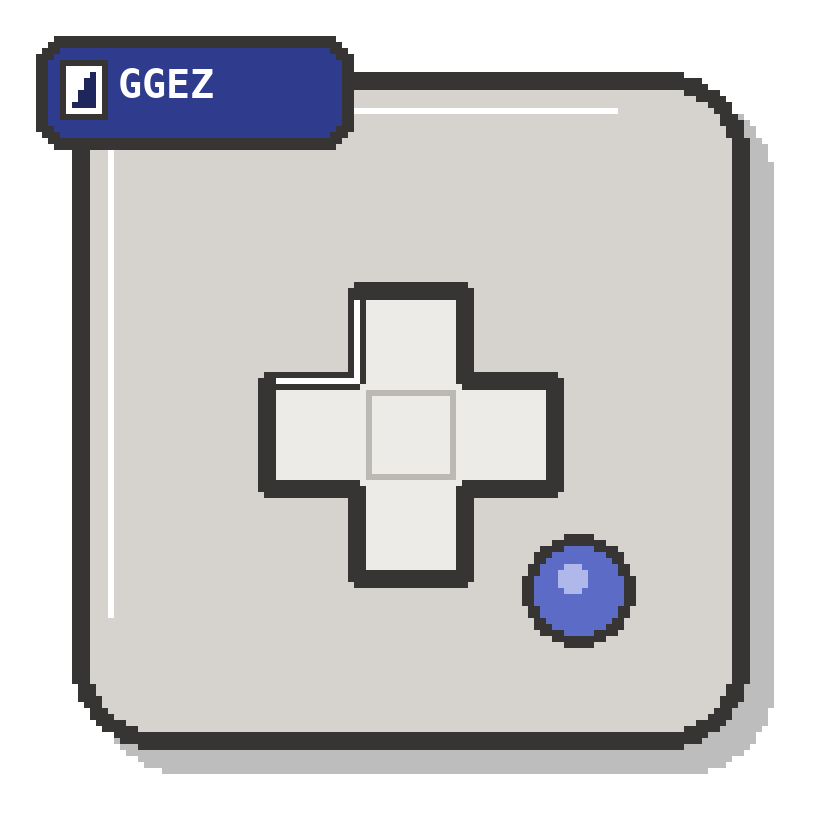
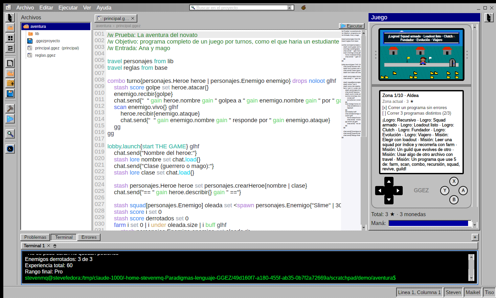
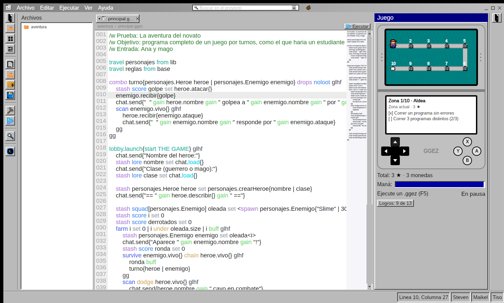
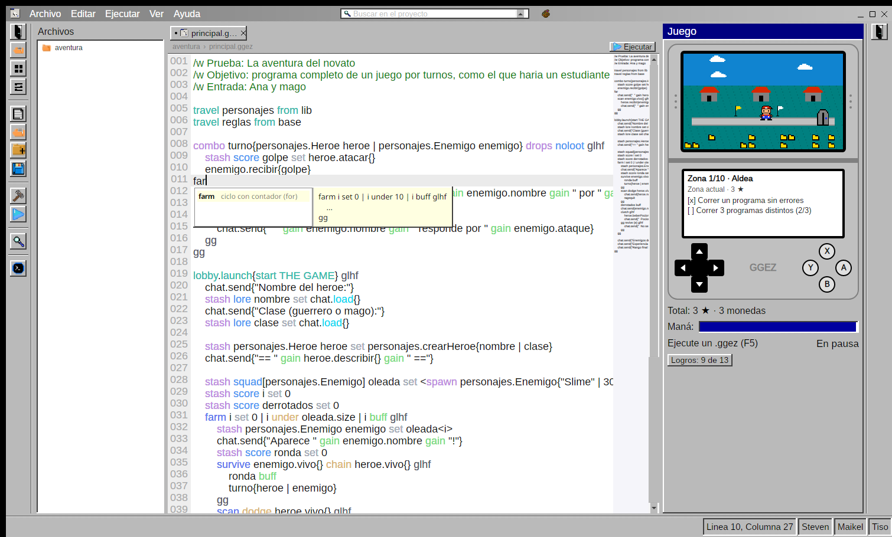
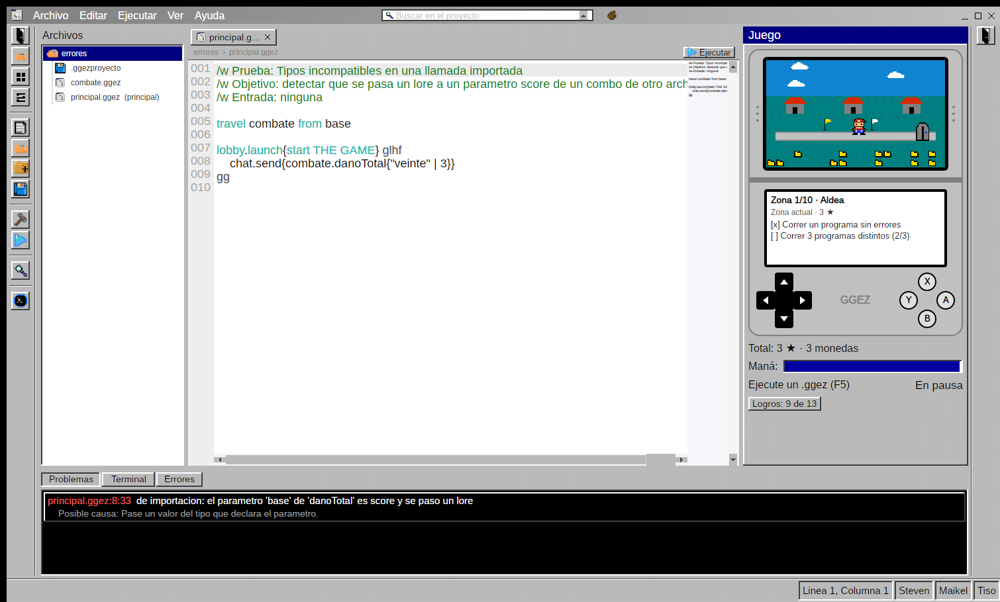
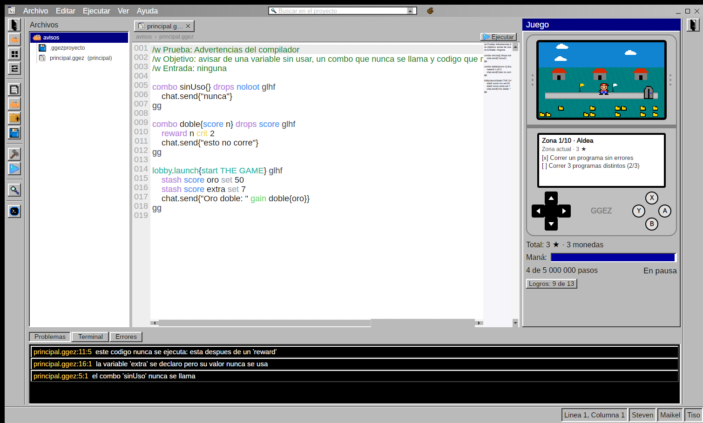
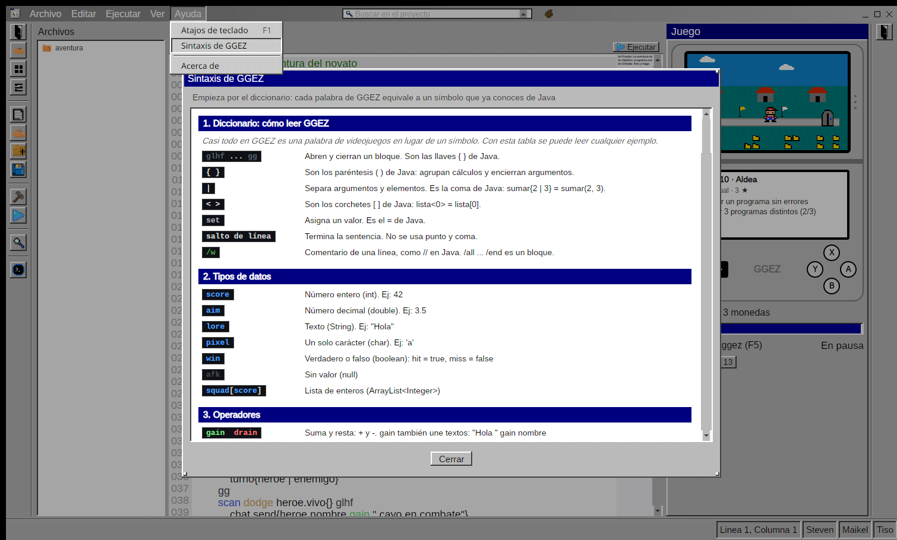
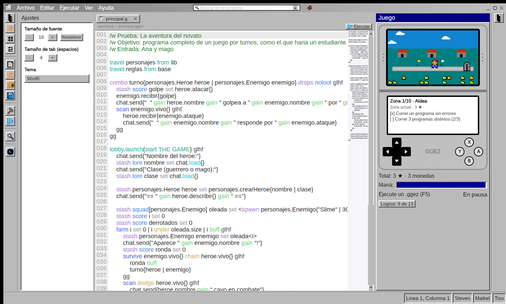
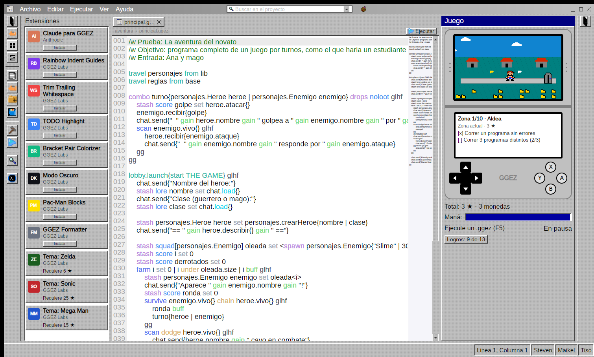
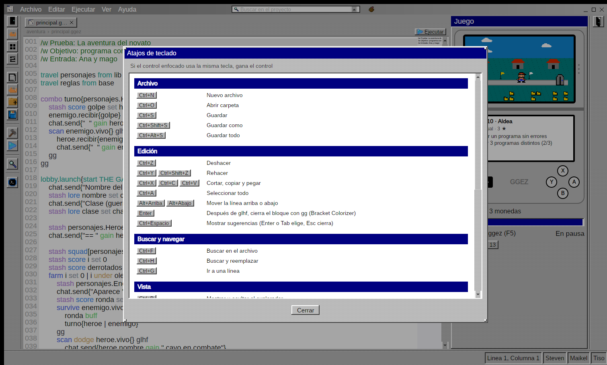

<div align="center">



# GGEZ

**Un lenguaje de programación con alma de videojuego.**

Programar se vuelve una partida: maná, niveles, estrellas, logros y un mundo que avanza a medida que tu código funciona.




</div>

---

## Instalación

Basta con un comando. No necesitas instalar Python ni .NET: el ejecutable ya trae todo adentro.

**Linux**

```bash
curl -fsSL https://raw.githubusercontent.com/VstevenMata/Paradigmas_lenguaje_GGEZ/main/instalar.sh | bash
```

Se abre un instalador en la terminal con estética de Windows 95. Ahí eliges el sistema y la carpeta donde guardar el ejecutable. Al terminar, puedes abrir GGEZ escribiendo `ggez` en la terminal o desde el menú de aplicaciones.

Funciona en cualquier distro con glibc 2.27 o superior (Ubuntu 18.04+, Debian 10+, Arch, Fedora…). Distros con musl, como Alpine, no están soportadas.

**NixOS / [nix](https://nixos.org/download/)**

```bash
# Abrir GGEZ sin instalarlo
nix run github:VstevenMata/Paradigmas_lenguaje_GGEZ

# O instalar el comando ggez para tu usuario
nix profile install github:VstevenMata/Paradigmas_lenguaje_GGEZ
```

En nix no aparece el instalador: el propio nix descarga GGEZ y abre la app directamente. La primera vez tarda un poco más y después queda en caché. Si lo instalaste con `nix profile`, se abre escribiendo `ggez` y se actualiza con `nix profile upgrade --all`.

NixOS no puede correr el ejecutable suelto, así que el flake lo ejecuta dentro de un entorno con las librerías que necesita.

**Windows** (PowerShell)

```powershell
irm https://raw.githubusercontent.com/VstevenMata/Paradigmas_lenguaje_GGEZ/main/instalar.ps1 | iex
```

También puedes descargar `GGEZ` o `GGEZ.exe` directamente desde [Releases](https://github.com/VstevenMata/Paradigmas_lenguaje_GGEZ/releases/latest).

---

## ¿Qué es GGEZ?

GGEZ es un lenguaje textual completo, imperativo y orientado a objetos como Java, pero con vocabulario de videojuegos. Está pensado para estudiantes de primer ingreso: cada concepto nuevo se asocia con algo que ya conocen. Como la estructura es la de un lenguaje convencional, lo aprendido se puede pasar después a Java, C# o Python.

El nombre viene de *GG EZ* («good game, easy»), lo que dicen los jugadores al terminar una partida.

```ggez
/w Primer programa en GGEZ

lobby.launch{start THE GAME} glhf
    chat.send{"Hola desde GGEZ"}

    hardcoded score MINIMO set 60
    stash score puntos set 85

    scan puntos atleast MINIMO glhf
        chat.send{"Aprobado con " gain puntos}
    gg fallback glhf
        chat.send{"Sigue intentando"}
    gg
gg
```

| GGEZ | Significado | En Java |
|---|---|---|
| `glhf` … `gg` | abre y cierra un bloque | `{` … `}` |
| `stash` / `hardcoded` | variable / constante | `int x = …` / `final` |
| `score`, `aim`, `lore`… | tipos | `int`, `double`, `String`… |
| `scan` / `fallback` | condicional | `if` / `else` |
| `loadout` / `pick` / `noob` | selección múltiple | `switch` / `case` / `default` |
| `farm`, `survive` | ciclos | `for`, `while` |
| `ragequit` / `respawn` | salir del ciclo / siguiente vuelta | `break` / `continue` |
| `combo` … `drops` | función con retorno | método |
| `squad`, `inventory`, `guild` | vector, registro, clase | arreglo, record, `class` |
| `spawn` | crear un objeto | `new` |
| `clutch` / `revive` / `checkpoint` | manejo de errores | `try` / `catch` / `finally` |
| `travel … from` | importar otro archivo | `import` |

La gramática completa está en [`Traductor/GRAMATICA.md`](Traductor/GRAMATICA.md) y hay programas de ejemplo en [`Traductor/ejemplos/`](Traductor/ejemplos/).

---

## Modo consola

Además del IDE, el comando `ggez` permite programar directo en la terminal:

```bash
ggez play                 # consola interactiva: escribes código y ves el resultado al instante
ggez run juego.ggez       # ejecuta un archivo sin abrir el IDE
ggez compile juego.ggez   # solo revisa errores
ggez game-over            # desinstala GGEZ (pide confirmación; tus archivos .ggez no se tocan)
```

```
 ggez›  stash score vidas set 3
✔ listo (no imprimió nada)
 ggez›  stash score i set 0
✔ listo (no imprimió nada)
 ggez›  farm i set 0 | i under vidas | i buff glhf
  ...       chat.send{"Vida " gain i}
  ...   gg
Vida 0
Vida 1
Vida 2
 ggez›  chat.send{vidas split 0}
✖ error en ejecucion (línea 1, columna 17): division entre cero
  posible causa: Verifique que el divisor no sea 0 antes de dividir.
```

En la consola no hace falta `lobby.launch`. Las variables, `combo`, `guild` e `inventory` se recuerdan entre entradas, y los bloques se ejecutan al cerrar su `gg`. Escribe `ayuda` para ver los comandos y `salir` para terminar.

---

## El IDE

Un entorno completo en una sola ventana: explorador de archivos, editor con resaltado y minimapa, terminal integrada y un panel de **juego** que reacciona a tu código.

<table>
<tr>
<td width="50%"><br><b>Mundo y misiones.</b> Cada programa que corre bien hace avanzar al personaje por 10 zonas con misiones, estrellas, monedas y logros.</td>
<td width="50%"><br><b>Autocompletado.</b> Plantillas para cada estructura del lenguaje, con su descripción.</td>
</tr>
<tr>
<td><br><b>Errores claros.</b> Cada error indica archivo, línea, columna y la posible causa.</td>
<td><br><b>Advertencias.</b> Avisos en amarillo para el código que funciona pero se puede mejorar.</td>
</tr>
<tr>
<td><br><b>Referencia integrada.</b> Cada ejemplo de GGEZ junto a su equivalente en Java.</td>
<td><br><b>Ajustes y temas.</b> Temas Win95, Zelda, Mega Man y Sonic.</td>
</tr>
<tr>
<td><br><b>Extensiones.</b> Vista para administrar las extensiones del IDE.</td>
<td><br><b>Atajos.</b> <code>F5</code> ejecutar, <code>F6</code> compilar, <code>F1</code> ver todos los atajos.</td>
</tr>
</table>

---

## Documentación

- 📘 [Manual de usuario](docs/Manual_Usuario_GGEZ.pdf)
- 📗 [Documentación del proyecto](docs/Documentacion_GGEZ.pdf)
- 📐 [Gramática del lenguaje](Traductor/GRAMATICA.md)
- 🔌 [Traductor y su contrato con el IDE](Traductor/README.md)

---

## Para desarrolladores

### Estructura

```
Paradigmas_lenguaje_GGEZ/
├── instalar.sh / instalar.ps1     ← instaladores de un comando (Linux / Windows)
├── publicar.sh                    ← genera los ejecutables únicos en dist/
├── flake.nix                      ← entorno reproducible para Linux (SDK .NET)
├── docs/                          ← manual, documentación (LaTeX + PDF) y capturas
├── Traductor/                     ← lexer, parser, semántico e intérprete (Python)
└── ParadigmasLenguajePropio/      ← IDE de escritorio (C# + Avalonia, MVVM)
    └── src/ParadigmasLenguajePropio/
        ├── Views/ ViewModels/ Models/
        ├── Services/              ← compilación, terminal, instalación, juego
        ├── Controls/              ← editor, bisel Win95, etc.
        ├── Themes/Paletas/        ← un .axaml por tema
        └── Assets/                ← íconos y fuentes
```

### Correrlo desde el código

**Linux (con nix).** Si el daemon está apagado, primero: `sudo systemctl start nix-daemon`.

```bash
nix run .#up                    # compila y abre el IDE

nix develop                     # o a mano, dentro del entorno
dotnet run --project ParadigmasLenguajePropio/src/ParadigmasLenguajePropio
```

**Windows.** Instala el [SDK de .NET 10](https://dotnet.microsoft.com/download) y Python 3.10 o superior:

```powershell
dotnet run --project ParadigmasLenguajePropio\src\ParadigmasLenguajePropio
```

**Solo el traductor:**

```bash
cd Traductor
python ggezc.py run ejemplos/clasificador.ggez
python ggezc.py play      # consola interactiva
```

### Publicar una versión

Los comandos de instalación usan dos cosas distintas de GitHub, y cada una se actualiza de una forma:

| Qué cambió | De dónde lo baja la gente | Cómo se actualiza |
|---|---|---|
| `instalar.sh` / `instalar.ps1` | la rama `main` | `git push` |
| El IDE o el traductor (los ejecutables) | el release más reciente | `gh release` |

**Cambiaste los instaladores:**

```bash
git add instalar.sh instalar.ps1
git commit -m "Actualiza instaladores"
git push
```

**Cambiaste el IDE o el traductor:** primero genera los ejecutables (`dist/GGEZ` y `dist/GGEZ.exe`, con Python portátil adentro) y después elige una de estas dos opciones:

```bash
./publicar.sh todo

# Opción A: versión nueva (recomendado)
gh release create v1.1 dist/GGEZ dist/GGEZ.exe --title "GGEZ 1.1" --notes "Qué cambió"

# Opción B: reemplazar los archivos del release que ya existe
gh release upload v1.0 dist/GGEZ dist/GGEZ.exe --clobber
```

Los instaladores siempre descargan el release más reciente, así que el comando de instalación no cambia entre versiones. Para ver qué hay publicado: `gh release list`.

**NixOS:** el flake apunta a un release fijo con su hash. Al publicar una versión nueva, actualiza en `flake.nix` la `url` de `ggezRelease` y su `sha256`, que se obtiene con:

```bash
nix-prefetch-url https://github.com/VstevenMata/Paradigmas_lenguaje_GGEZ/releases/download/v1.1/GGEZ
```

---

## Equipo

Proyecto final del curso **Paradigmas de Programación**
Universidad Nacional, Sede Regional Brunca · II Ciclo 2026

- Steven Mata Quirós
- Maikel Segura Quirós
- Angel Ureña Naranjo

Profesor: Pablo A. Venegas Elizondo

<div align="center">

*«Todo lo puedo en Cristo que me fortalece.» — Filipenses 4:13*

</div>
